# HITL Feature Lab

This tutorial walks through the local labeling board. The board keeps one category graph, recommends images from a candidate pool, trains a feature map from the labels, and then trains a classifier or a ranker on either the original features or the mapped features.

The figures below use the English labels. The board opens in Chinese. Use the language button in the header to switch.

## Set up

Create a conda environment and install the requirements. Do not install them into the base environment.

```bash
conda create -n hitl-feature-lab python=3.10 -y
conda run -n hitl-feature-lab python -m pip install -r requirements.txt
```

From the repository root, unpack the demo images and start the board:

```bash
mkdir -p subset/images
unzip subset/images.zip -d subset/images
conda run -n hitl-feature-lab python scripts/run_web.py
```

Open `http://127.0.0.1:5002`. The server listens on that address only. The form defaults are the feature file `datasets/fama_base/features.h5` and the image directory `subset/images`. Both paths are resolved from the directory where the server was started. `datasets/ae/features.h5` is an alternate feature table on the same catalog indexes and the same images.

A project is stored in the server's session directory, `web_sessions/` by default. That directory holds the category graph, the feature map, the classification and ranking models, and the rest of the session. There is no separate database. Restarting the server loads the projects already saved there.

## The board

After a project opens, the page has three columns.

- The left column is the current round. **Suggest** recommends new images. **Current** shows images already in the open category. **Recycle** shows the recycle bin.
- The center column is the category graph, or a UMAP of the pool. **Graph** and **UMAP** switch that view.
- The right column opens on **Features**, where the map is trained. **Classes** is the classification and ranking panel.

**Unfrozen** lets you drag category cards. **Frozen** keeps the cards still so you can drag a card into the recommend well or into a task class. `F` toggles freeze when the cursor is not in a text field. **Separation** draws edges by the strength you set. **Mean distance** draws them by the average mapped distance and is the default.

## 1. Create a project

A project needs a name. Type it in **Project name**, set the feature file, image directory, pool size, seed, output dimension, round size, and epochs, then click **Create project**.

The name cannot be empty, cannot repeat a saved project, and cannot contain `|` or a path separator. The directory on disk stays an id. The name is what the board shows.

**Saved projects** lists projects already in the session directory. Choose one and click **Open project** to continue it, including its graph, map, and task models.

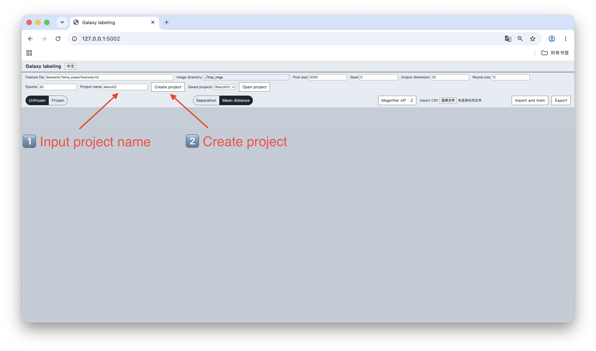

## 2. Recommend samples

In **Suggest**, set **Mode** to **Random** and click **Recommend**. The left column fills with unlabeled images from the pool. **Prev** and **Next** move through the round. The caption under each image is its catalog index until a later mode attaches a class and a score.

The other modes are:

- **Diversity** spreads the round across the pool.
- **Unknown** prefers images far from the labeled examples.
- **Certain** prefers images the scoped classes explain most clearly.
- **Uncertain** prefers images those classes explain least clearly.

The menu also includes an algorithmic schedule. The first round is random. Later rounds use **Unknown** when two or more categories are in scope, and **Diversity** otherwise.

**Categories**, under the images, limits the scope. An empty well means every category at the current level. While the graph is frozen, drag a category card into the well. **All** and **Clear** fill or empty it.

**×n** is the widen factor, default 10. It matters when a scope is set and the nearest-neighbor vote assigns no pool image to those classes. The board then ranks the pool by the best score among the scoped classes, keeps the top `n` times the round size, and runs the selected mode on that subset. If the vote does find in-scope images, the candidate set stays as before. The caption names the scoped class and the score used for that ranking, not the global vote.

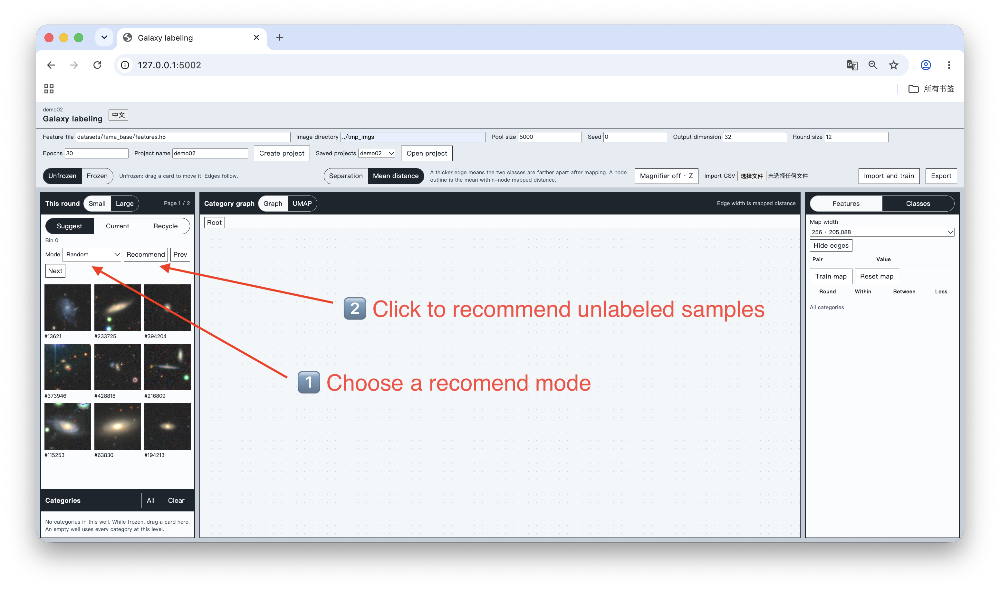

### 2.1 Inspect one image

**Magnifier off · Z** turns the magnifier on. Press `Z` to do the same when the cursor is not in a text field. Hover an image to enlarge it. Press the button or `Z` again to turn it off.

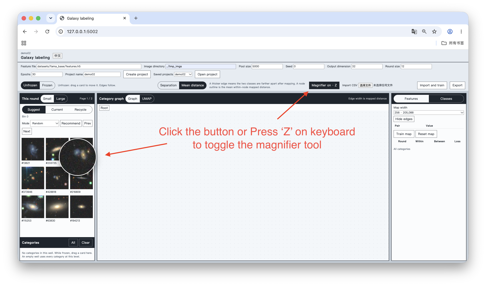

### 2.2 Large figures

**Small** is the default and shows several images in a grid. **Large** shows one image per row. Use it with the magnifier when a thumbnail is not enough.

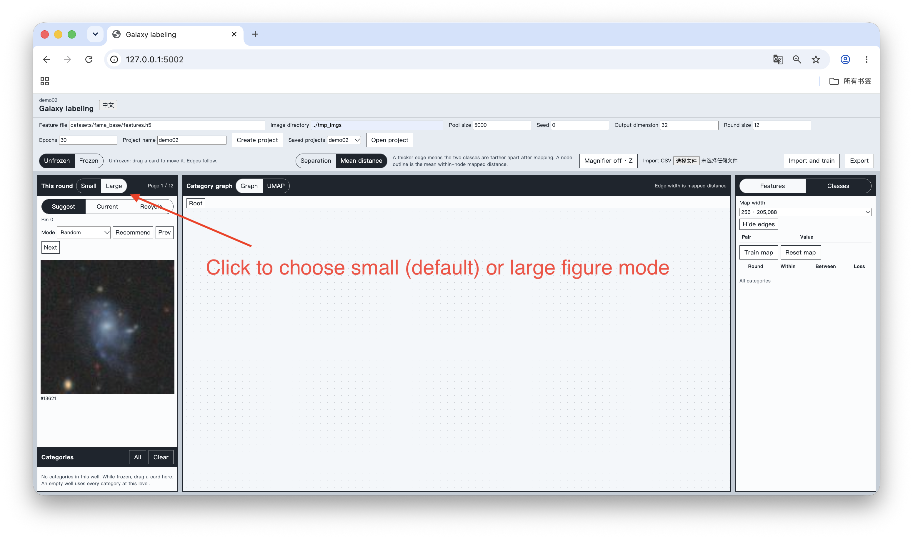

## 3. Build the category graph

Drag an image from the left column onto the blank graph. The board asks for a category name and creates a card. Drag another image onto that card to add it to the same category. Each image belongs to one category.

A name cannot contain `|`. The same name may be used again under a different parent. A sibling of the same name is rejected. While the graph is unfrozen, drag a card to place it. Edges follow the cards.

**Current** lists images in the open category. **Recycle** moves an image out of the graph without deleting the file. The card border and the left bar use that category's color.

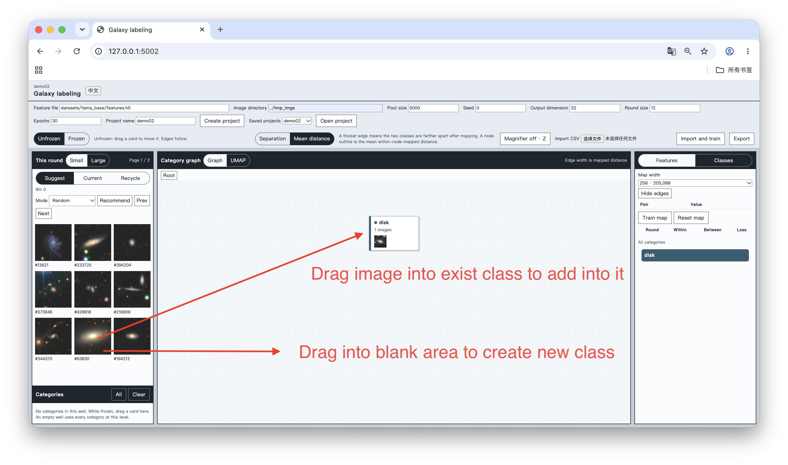

## 4. Import a catalog

**Import CSV** reads labels you already have. Choose the file. The dialog asks for the index column, then one or more label columns in level order. **Add label column** adds another level. **Up** and **Down** change that order. Nothing is imported until you click **Import and train**.

A label that already exists under the same parent receives the sample. A new name becomes a new category. The import then trains the feature map. **Export** writes each placed image with its ancestor names and skips the recycle bin.

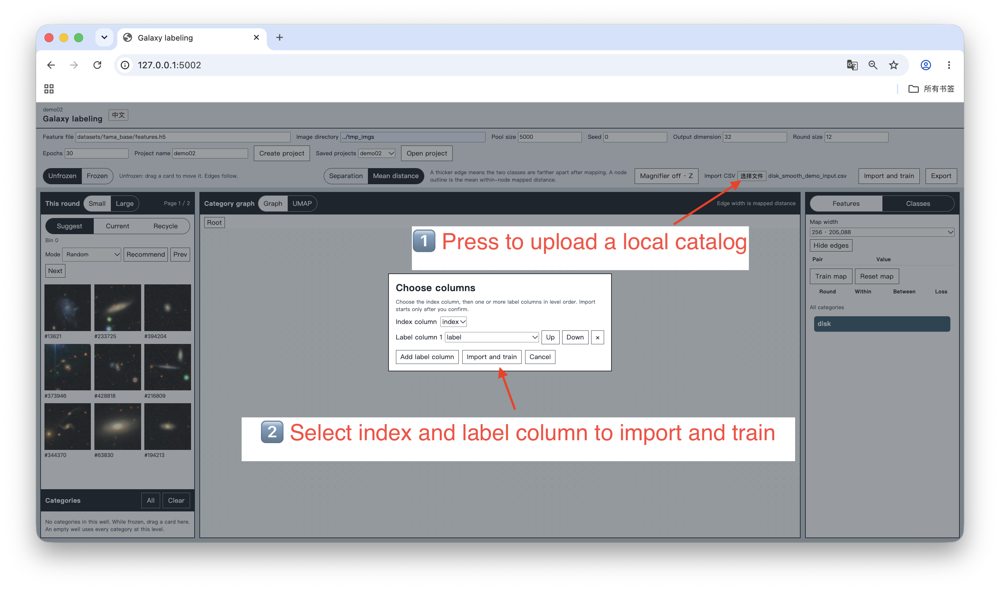

## 5. Find images of a known type

After the map has been trained, freeze the graph. Drag the category you care about into **Categories**. Set **Mode** to **Certain** and click **Recommend**. The round prefers images close to that category. Each caption is the scoped class and the score used to rank the row.

If the nearest-neighbor vote names none of the scoped classes, the round is not empty. **×n** decides how large a slice of the pool is passed to **Certain**. Raise or lower it before you click **Recommend**.

**Train map** on the **Features** panel fits the map from the current graph. **Map width** chooses the hidden width. Changing the width discards the current module, so train again. **Reset map** clears the module. The edge table records within-class distance, between-class distance, and loss for each round.

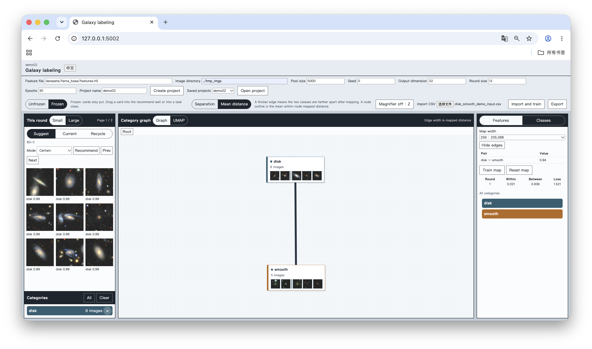

## 6. Train a classifier

Open **Classes**. Click **New class**, then drag category cards from the graph into that class. Freeze the graph first, or the drag moves the card instead. A task class can hold more than one category. **Rename** and **Delete** edit that class. **Clear** removes every task class.

**Mapped** uses the feature map and stays unavailable until **Train map** has succeeded. **Raw** always uses the original features. **Model size** is the classifier width for the selected input. **Train**, **Val**, and **Test** are the split.

**Train classifier** fits the model. The summary reports accuracy and ROC AUC for the split. **Show results** returns to a saved result. **Predict** scores the whole pool with the active model and shares **Result count** with **Show results**. Saved results can be renamed or deleted. The name cannot contain `|`.

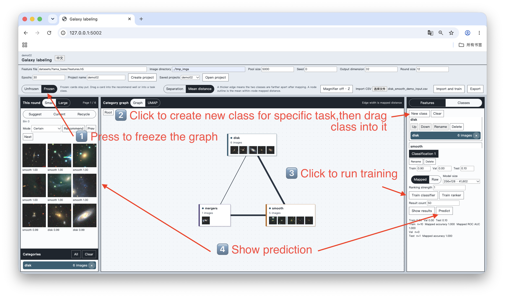

## 7. Close the loop, then rank

Repeat recommend, label, and **Train map**. Each round adds to the same graph, and the map keeps training on that graph. When the categories are stable, use them in **Classes**.

**Train ranker** is the other head. Put the categories in order, set **Ranking strength**, and train. The strength must be positive. The summary reports pairwise accuracy. **Predict** and **Show results** work for a saved ranking result as well. Ranking scores are ordered highest first, as classification scores are.

Use **Raw** and **Mapped** on the same task classes to compare the original features with the map.

## Advanced operations

### A.1 Compare the map with UMAP

In the center header, click **UMAP**. The left pane is the original features. The right pane is the mapped features. Gray points are the candidate pool. Colored points are labeled images, one color per category.

Hover a labeled point to see its image and category. The card floats over the plot and does not move the layout. Click the point to keep the card until you click another labeled point or empty space. Leave the point and the card hides if you have not pinned it.

The raw coordinates are fit once for a pool. The mapped coordinates are fit again when the map changes.

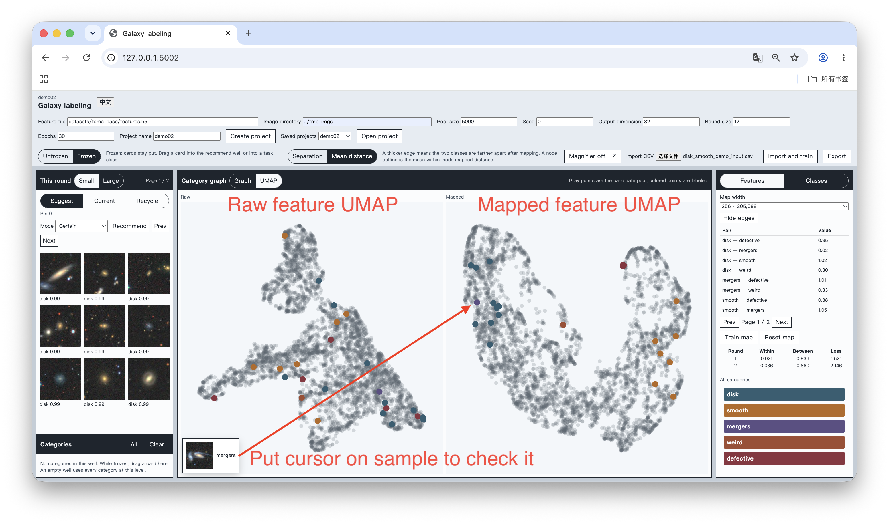

### A.2 Add subclasses

Double-click a category card to open it. The breadcrumb shows the path back to **Root**. **Current** then lists images in that category. **No subclass only**, under those images, hides images that already have a child category. It is on by default.

Drag an image onto the blank area to create a subclass, or onto a child card to assign it. This is the same drag as at the root. Recommend from **Suggest** while a subclass is in the well searches the full pool, and it needs a trained map and labeled examples. Recommend from **Current** stays inside the open category.

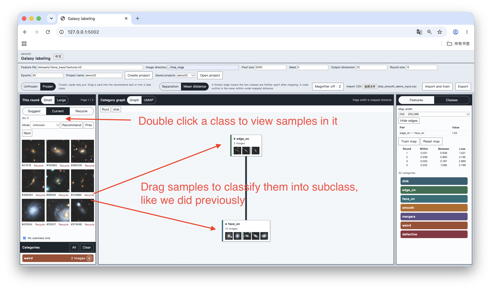

### A.3 Read the mean distance

**Mean distance** makes a thicker edge mean the two categories are farther apart after mapping. Click an edge to highlight its row in the table. The row is the pair and the value. Click a column name to sort, and click it again to reverse the order. **Prev** and **Next** under the table change pages. **Hide edges** closes the table. **Show edges** opens it.

**Separation** uses the same table, but the value is the strength you set, from 0 to 2, instead of the mapped distance.

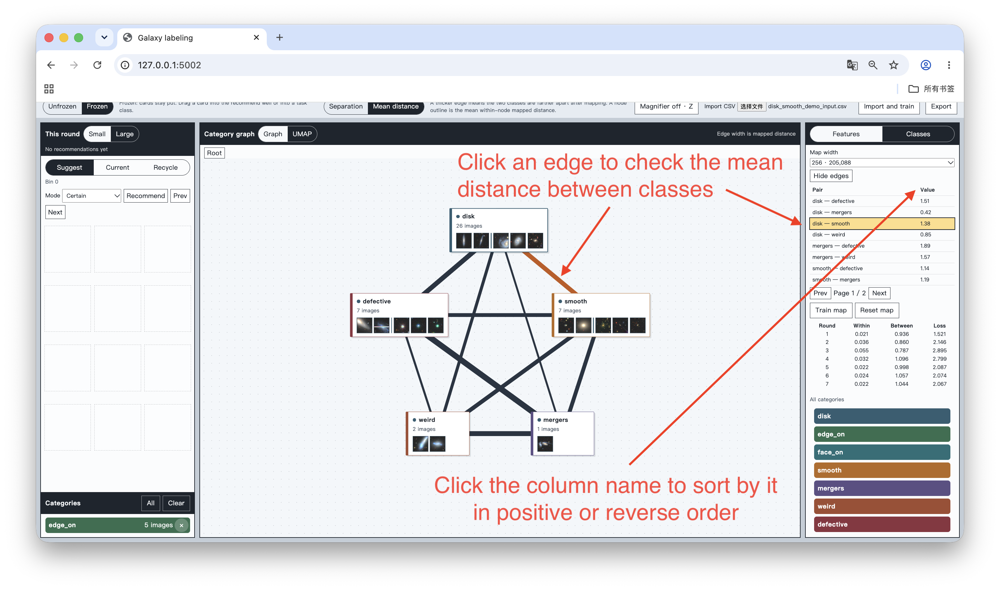
